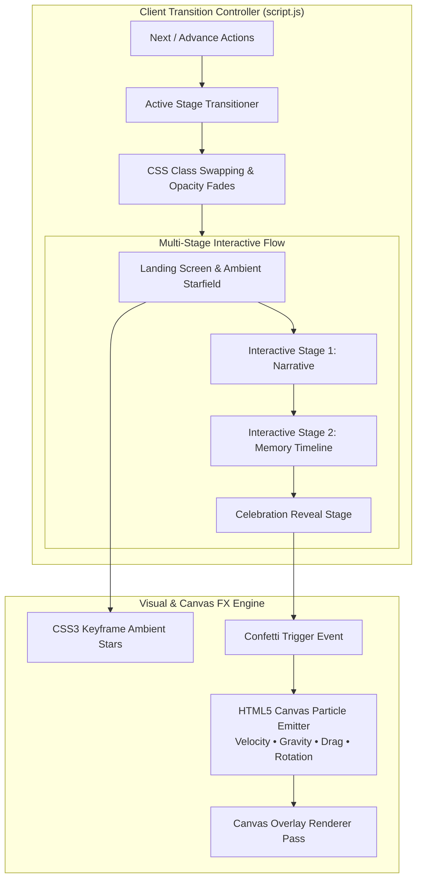

<p align="center">
  
</p>

# ◈ Interactive Birthday Celebration Experience

[](https://github.com/ISBANDURAHUMAN-R/BIRTHDAY/actions/workflows/ci.yml)

## ◆ About the Project
This repository hosts a self-contained interactive web greeting application built with modern front-end styling. Designed as a digital greeting card, it guides the user through an animated storytelling progression leading to a celebration reveal and personalized greeting.

## ❖ Key Features
- Multi-stage interactive story progression with smooth section transitions.
- Dark-mode visual presentation with starfield animations and glassmorphism cards.
- HTML5 Canvas particle confetti burst upon reaching the reveal screen.
- Responsive, lightweight client-side architecture requiring no backend or external frameworks.

## ◆ System Architecture


## ⬢ Technologies Used
- HTML5 & CSS3
- JavaScript (ES6 Vanilla)
- HTML5 Canvas API

## § Requirements
- Modern web browser

## ▲ Installation & Execution
```bash
# Open index.html directly or serve locally
python -m http.server 8000
```
Open `http://localhost:8000` in your web browser.

## ※ Developer
Developer: ISBANDU RAHUMAN R  
GitHub: https://github.com/ISBANDURAHUMAN-R
